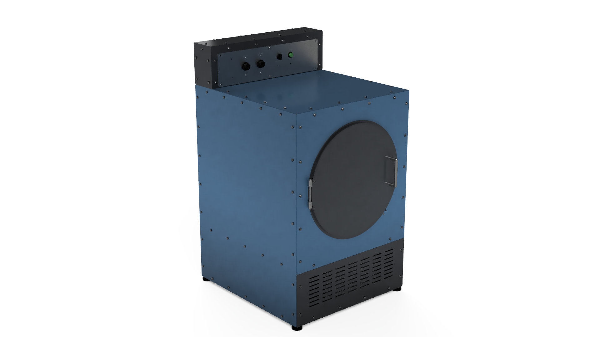

# dryer

Open Source Appliances: clothes dryer.

*A render of the CAD model, not a photograph. Nothing has been built.*

## Where this project stands

**A complete paper design that has never been built, powered, or independently reviewed. Do not build from it yet.** There is no tagged release.

| Stage | State |
| --- | --- |
| Design (electric reference build, Tier 0 controls) | Drawn: all 213 parts, model draft 9, with DXFs, STEP files, a cut list, wiring documents and a BOM |
| Computer checks of the drawings | Done by the author: no part overlaps another, every hole matches its fastener, and the model measures the same in two independent CAD kernels (OpenCascade and Autodesk Fusion) and while the door, drum and drive move |
| Paper design review (`docs/verification.md` Gate 0) | 10 of 23 checks have results, 4 wait on real parts, **9 not done**, among them the electrical ones: contactor and relay ratings, the 24 V budget, the breaker against the motor start, wire gauges, heater limits and thermostat settings, and the interlock truth table |
| Real parts measured against the drawings (Gate 1) | **0 of 16.** No part has been bought |
| Bench tests (Gate 2) | **0 of 8** |
| Assembled, unpowered (Gate 3) | **0 of 11** |
| Commissioning and test run (Gates 4 and 5) | **Not started; 0 of 8 test-run checks.** It has never been powered |
| Bill of materials | Specs complete (`bom/order-plan.csv`). The electrical, appliance, frame, fastener and stock parts were found for sale and priced on 2026-11-09, about 3500 USD before shipping (`bom/sourcing-2026-11-09.md`). **The drive (motor, pulley, belt, idler) and the blower have no catalog match yet, the laser-cut plates are not priced, and the BOM's second-source part numbers are still unverified** |
| Independent review | **None.** Every check so far was done by the author. The design was drafted with heavy AI assistance (Claude), which is one more reason every number needs a human check |

The open checks are listed with how to run them in `docs/verification.md`. Many drawings have holes placed from a seller's listing or a datasheet rather than a part in hand; those DXFs are marked there as not to be cut until their check closes.

## Risk statement

This is an uncertified appliance design published for free by individuals with no organization behind it. It involves mains voltage, heat, moving parts, and in some cases water and refrigerant. Building or operating it can cause fire, electric shock, injury, property damage, or death. There is no warranty of any kind. You are responsible for your own build, for checking it against your local electrical and building codes, and for deciding whether to use it. If you are not confident you can do that, do not build this.

## What it is

A vented clothes dryer built the opposite way from a commercial one: an overbuilt frame and drum that should never need replacing, catalog wear parts (belt, bearings, rollers, felts, element, thermostats, motor) that any appliance parts house or industrial supplier can sell you, and a control module that unplugs from one connector and can be replaced by whatever controls exist decades from now.

It is specified as a range on one chassis:

- Tier 0: a mechanical timer and a heat switch. No microcontroller, no firmware. This is the reference build and the only one that has to exist for the dryer to count as done.
- Tier 1: a small microcontroller with buttons and LEDs or a character display.
- Tier 2: a networked board with a local web interface. Local control only.
- Tier 3: an open slot with a published footprint and pinout for anything else.

## Choose your heat

The same chassis takes one of four heat modules. Pick one; the module and the cord are all that changes. Details in `docs/design-rules.md` section 1.

| Choice | Needs | Dries a load in | Where it stands |
| --- | --- | --- | --- |
| None | A 120 V outlet | It does not; it tumbles and airs | Part of every build (it is how every build is first commissioned) |
| Electric | A 240 V, 30 A dryer circuit | About an hour | The reference build |
| Gas | A 120 V outlet, a gas line, and a vent outdoors | About an hour | Variant, after the reference build |
| Heat pump | A 120 V outlet and a drain | 2 to 3 hours | Variant, blocked until a sealed unit is confirmed |

## What it will not do

- It will not be certified. See the risk statement.
- It will not be cheaper than a used dryer. It is meant to be the last dryer you buy.
- It will not contain a refrigeration circuit anyone has opened. The heat pump option is a sealed unit or nothing.
- It will not rely on any cloud service, account, or app. If a feature needs the internet, it is not a feature of this dryer.

## Where to start

1. `controls/uci-spec.md`, the Universal Control Interface for the dryer family. Everything else plugs into this.
2. `docs/design-rules.md`, the dryer-specific targets and rules that the CAD and the wiring must meet.
3. `docs/verification.md`, every check between this paper and a test run, with its gate.
4. `DECISIONS.md`, every design decision and every departure from the charter, newest first.
5. `mechanical/cad/osa_dryer_cad.py`, the parametric model (213 parts: every plate, extrusion, bolt, foot, the belt and idler, the door hardware and switch, the drum's glides and roller studs, the ducts as plates on flat bar frames with the throat liner and the lint basket, the blower plate and the exhaust pipe with its clamps and tap, the exhaust thermistor and the moisture bars, the electric heat module, the common power module, the Tier 0 module, the bought parts as representations); `mechanical/drawings/` has its DXFs, the cut list, and check views; `mechanical/step/` the STEP files. `mechanical/cad/cad_audit.py` measures every file the model writes against the documents and leaves its report in `mechanical/cad/audit/`; `mechanical/fusion/osa-dryer-assembly-motion.f3d` is the design of record (`DECISIONS.md` 2026-11-06) and `mechanical/fusion/osa-dryer-parametric.f3d` is the version a builder edits in Fusion's own interface (product renders of it, the whole machine and each module, are in `mechanical/renders/`): the same 213 parts drawn natively from user parameters by `mechanical/cad/fusion_build/fusion_build.py`, with the joints and appearances, checked part by part against the script's files (`mechanical/cad/fusion_build/README.md`, `mechanical/cad/audit/fusion-build-report.md`); `mechanical/cad/fusion_audit/` repeats the measurements inside Autodesk Fusion, `mechanical/cad/audit/fusion-visual-check.md` is the by-hand check in Fusion with screenshots, and `mechanical/cad/fusion_motion/` gives the Fusion assembly its joints and materials and runs the interference check while things move (`mechanical/cad/audit/fusion-motion-check.md`; the resulting archive is `mechanical/fusion/osa-dryer-assembly-motion.f3d`).

## Charter

This repo follows the Open Source Appliances Design Charter, kept in the `charter` repo of the same organization. If this repo and the charter disagree, the charter wins unless `DECISIONS.md` records why not.

## Licenses

- Hardware: CERN-OHL-S v2 (`LICENSE-HARDWARE`)
- Firmware: GPLv3 (`LICENSE-SOFTWARE`)
- Documentation: CC BY-SA 4.0
